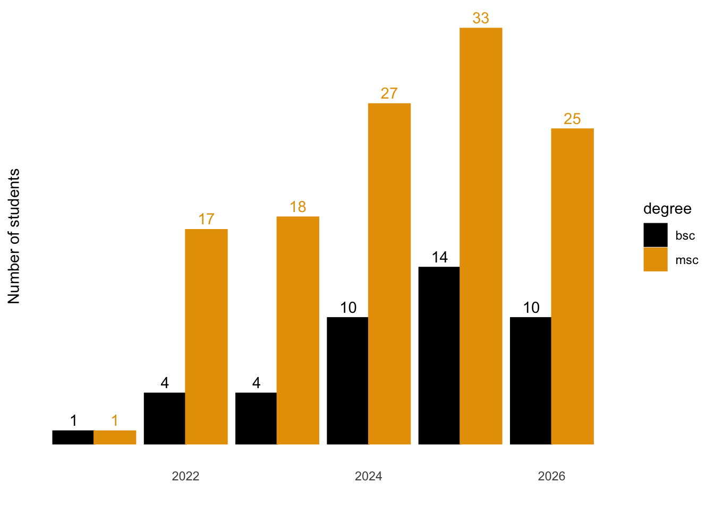

<!-- README.md is generated from README.Rmd. Please edit that file -->

# ghedata

<!-- badges: start -->

[](https://creativecommons.org/licenses/by/4.0/)

<!-- badges: end -->

The goal of ghedata is to share data resources that document the work of
the Global Health Engineering group at ETH Zurich. The data can be used
for research, teaching, and learning purposes. The data is available as
an R data package, in CSV and XLSX formats.

## Installation

You can install the development version of ghedata from
[GitHub](https://github.com/) with:

``` r
# install.packages("devtools")
devtools::install_github("global-health-engineering/ghedata")
```

``` r
## Run the following code in console if you don't have the packages
## install.packages(c("dplyr", "knitr", "readr", "stringr", "gt", "kableExtra"))
library(dplyr)
library(knitr)
library(readr)
library(stringr)
library(gt)
library(kableExtra)
library(ggthemes)
library(ggplot2)
```

Alternatively, you can download the individual datasets as a CSV or XLSX
file from the table below.

1.  Click Download CSV. A window opens that displays the CSV in your
    browser.
2.  Right-click anywhere inside the window and select “Save Page As…”.
3.  Save the file in a folder of your choice.

| dataset | CSV | XLSX |
|:---|:---|:---|
| people | [Download CSV](https://github.com/global-health-engineering/ghedata/raw/main/inst/extdata/people.csv) | [Download XLSX](https://github.com/global-health-engineering/ghedata/raw/main/inst/extdata/people.xlsx) |
| computational | [Download CSV](https://github.com/global-health-engineering/ghedata/raw/main/inst/extdata/computational.csv) | [Download XLSX](https://github.com/global-health-engineering/ghedata/raw/main/inst/extdata/computational.xlsx) |
| github_organisations | [Download CSV](https://github.com/global-health-engineering/ghedata/raw/main/inst/extdata/github_organisations.csv) | [Download XLSX](https://github.com/global-health-engineering/ghedata/raw/main/inst/extdata/github_organisations.xlsx) |
| github_repositories | [Download CSV](https://github.com/global-health-engineering/ghedata/raw/main/inst/extdata/github_repositories.csv) | [Download XLSX](https://github.com/global-health-engineering/ghedata/raw/main/inst/extdata/github_repositories.xlsx) |
| github_repository_types | [Download CSV](https://github.com/global-health-engineering/ghedata/raw/main/inst/extdata/github_repository_types.csv) | [Download XLSX](https://github.com/global-health-engineering/ghedata/raw/main/inst/extdata/github_repository_types.xlsx) |
| github_commits | [Download CSV](https://github.com/global-health-engineering/ghedata/raw/main/inst/extdata/github_commits.csv) | [Download XLSX](https://github.com/global-health-engineering/ghedata/raw/main/inst/extdata/github_commits.xlsx) |
| github_commits_by_type | [Download CSV](https://github.com/global-health-engineering/ghedata/raw/main/inst/extdata/github_commits_by_type.csv) | [Download XLSX](https://github.com/global-health-engineering/ghedata/raw/main/inst/extdata/github_commits_by_type.xlsx) |
| proposals | [Download CSV](https://github.com/global-health-engineering/ghedata/raw/main/inst/extdata/proposals.csv) | [Download XLSX](https://github.com/global-health-engineering/ghedata/raw/main/inst/extdata/proposals.xlsx) |
| github_commits_by_person | [Download CSV](https://github.com/global-health-engineering/ghedata/raw/main/inst/extdata/github_commits_by_person.csv) | [Download XLSX](https://github.com/global-health-engineering/ghedata/raw/main/inst/extdata/github_commits_by_person.xlsx) |
| github_commits_by_members | [Download CSV](https://github.com/global-health-engineering/ghedata/raw/main/inst/extdata/github_commits_by_members.csv) | [Download XLSX](https://github.com/global-health-engineering/ghedata/raw/main/inst/extdata/github_commits_by_members.xlsx) |
| zenodo_records | [Download CSV](https://github.com/global-health-engineering/ghedata/raw/main/inst/extdata/zenodo_records.csv) | [Download XLSX](https://github.com/global-health-engineering/ghedata/raw/main/inst/extdata/zenodo_records.xlsx) |

## Data

The package provides access to 11 tables, described below by topic.

``` r
library(ghedata)
```

### people

The dataset `people` contains data about people that have worked for the
group. This includes staff, as well as undergraduate student projects.

It has 205 observations and 7 variables.

``` r
people |> 
  head(3) |> 
  gt::gt() |>
  gt::as_raw_html()
```

<div id="uzhlyujrba" style="padding-left:0px;padding-right:0px;padding-top:10px;padding-bottom:10px;overflow-x:auto;overflow-y:auto;width:auto;height:auto;">
  &#10;  <table class="gt_table" data-quarto-disable-processing="false" data-quarto-bootstrap="false" style="-webkit-font-smoothing: antialiased; -moz-osx-font-smoothing: grayscale; font-family: system-ui, 'Segoe UI', Roboto, Helvetica, Arial, sans-serif, 'Apple Color Emoji', 'Segoe UI Emoji', 'Segoe UI Symbol', 'Noto Color Emoji'; display: table; border-collapse: collapse; line-height: normal; margin-left: auto; margin-right: auto; color: #333333; font-size: 16px; font-weight: normal; font-style: normal; background-color: #FFFFFF; width: auto; border-top-style: solid; border-top-width: 2px; border-top-color: #A8A8A8; border-right-style: none; border-right-width: 2px; border-right-color: #D3D3D3; border-bottom-style: solid; border-bottom-width: 2px; border-bottom-color: #A8A8A8; border-left-style: none; border-left-width: 2px; border-left-color: #D3D3D3;" bgcolor="#FFFFFF">
  <thead style="border-style: none;">
    <tr class="gt_col_headings" style="border-style: none; border-top-style: solid; border-top-width: 2px; border-top-color: #D3D3D3; border-bottom-style: solid; border-bottom-width: 2px; border-bottom-color: #D3D3D3; border-left-style: none; border-left-width: 1px; border-left-color: #D3D3D3; border-right-style: none; border-right-width: 1px; border-right-color: #D3D3D3;">
      <th class="gt_col_heading gt_columns_bottom_border gt_left" rowspan="1" colspan="1" scope="col" id="title" style="border-style: none; color: #333333; background-color: #FFFFFF; font-size: 100%; font-weight: normal; text-transform: inherit; border-left-style: none; border-left-width: 1px; border-left-color: #D3D3D3; border-right-style: none; border-right-width: 1px; border-right-color: #D3D3D3; vertical-align: bottom; padding-top: 5px; padding-bottom: 6px; padding-left: 5px; padding-right: 5px; overflow-x: hidden; text-align: left;" bgcolor="#FFFFFF" valign="bottom" align="left">title</th>
      <th class="gt_col_heading gt_columns_bottom_border gt_left" rowspan="1" colspan="1" scope="col" id="degree" style="border-style: none; color: #333333; background-color: #FFFFFF; font-size: 100%; font-weight: normal; text-transform: inherit; border-left-style: none; border-left-width: 1px; border-left-color: #D3D3D3; border-right-style: none; border-right-width: 1px; border-right-color: #D3D3D3; vertical-align: bottom; padding-top: 5px; padding-bottom: 6px; padding-left: 5px; padding-right: 5px; overflow-x: hidden; text-align: left;" bgcolor="#FFFFFF" valign="bottom" align="left">degree</th>
      <th class="gt_col_heading gt_columns_bottom_border gt_left" rowspan="1" colspan="1" scope="col" id="type" style="border-style: none; color: #333333; background-color: #FFFFFF; font-size: 100%; font-weight: normal; text-transform: inherit; border-left-style: none; border-left-width: 1px; border-left-color: #D3D3D3; border-right-style: none; border-right-width: 1px; border-right-color: #D3D3D3; vertical-align: bottom; padding-top: 5px; padding-bottom: 6px; padding-left: 5px; padding-right: 5px; overflow-x: hidden; text-align: left;" bgcolor="#FFFFFF" valign="bottom" align="left">type</th>
      <th class="gt_col_heading gt_columns_bottom_border gt_left" rowspan="1" colspan="1" scope="col" id="b_m_student" style="border-style: none; color: #333333; background-color: #FFFFFF; font-size: 100%; font-weight: normal; text-transform: inherit; border-left-style: none; border-left-width: 1px; border-left-color: #D3D3D3; border-right-style: none; border-right-width: 1px; border-right-color: #D3D3D3; vertical-align: bottom; padding-top: 5px; padding-bottom: 6px; padding-left: 5px; padding-right: 5px; overflow-x: hidden; text-align: left;" bgcolor="#FFFFFF" valign="bottom" align="left">b_m_student</th>
      <th class="gt_col_heading gt_columns_bottom_border gt_right" rowspan="1" colspan="1" scope="col" id="start_date" style="border-style: none; color: #333333; background-color: #FFFFFF; font-size: 100%; font-weight: normal; text-transform: inherit; border-left-style: none; border-left-width: 1px; border-left-color: #D3D3D3; border-right-style: none; border-right-width: 1px; border-right-color: #D3D3D3; vertical-align: bottom; padding-top: 5px; padding-bottom: 6px; padding-left: 5px; padding-right: 5px; overflow-x: hidden; text-align: right; font-variant-numeric: tabular-nums;" bgcolor="#FFFFFF" valign="bottom" align="right">start_date</th>
      <th class="gt_col_heading gt_columns_bottom_border gt_right" rowspan="1" colspan="1" scope="col" id="year" style="border-style: none; color: #333333; background-color: #FFFFFF; font-size: 100%; font-weight: normal; text-transform: inherit; border-left-style: none; border-left-width: 1px; border-left-color: #D3D3D3; border-right-style: none; border-right-width: 1px; border-right-color: #D3D3D3; vertical-align: bottom; padding-top: 5px; padding-bottom: 6px; padding-left: 5px; padding-right: 5px; overflow-x: hidden; text-align: right; font-variant-numeric: tabular-nums;" bgcolor="#FFFFFF" valign="bottom" align="right">year</th>
      <th class="gt_col_heading gt_columns_bottom_border gt_left" rowspan="1" colspan="1" scope="col" id="thesis_title" style="border-style: none; color: #333333; background-color: #FFFFFF; font-size: 100%; font-weight: normal; text-transform: inherit; border-left-style: none; border-left-width: 1px; border-left-color: #D3D3D3; border-right-style: none; border-right-width: 1px; border-right-color: #D3D3D3; vertical-align: bottom; padding-top: 5px; padding-bottom: 6px; padding-left: 5px; padding-right: 5px; overflow-x: hidden; text-align: left;" bgcolor="#FFFFFF" valign="bottom" align="left">thesis_title</th>
    </tr>
  </thead>
  <tbody class="gt_table_body" style="border-style: none; border-top-style: solid; border-top-width: 2px; border-top-color: #D3D3D3; border-bottom-style: solid; border-bottom-width: 2px; border-bottom-color: #D3D3D3;">
    <tr style="border-style: none;"><td headers="title" class="gt_row gt_left" style="border-style: none; padding-top: 8px; padding-bottom: 8px; padding-left: 5px; padding-right: 5px; margin: 10px; border-top-style: solid; border-top-width: 1px; border-top-color: #D3D3D3; border-left-style: none; border-left-width: 1px; border-left-color: #D3D3D3; border-right-style: none; border-right-width: 1px; border-right-color: #D3D3D3; vertical-align: middle; overflow-x: hidden; text-align: left;" valign="middle" align="left">2021-staff-chair-141444</td>
<td headers="degree" class="gt_row gt_left" style="border-style: none; padding-top: 8px; padding-bottom: 8px; padding-left: 5px; padding-right: 5px; margin: 10px; border-top-style: solid; border-top-width: 1px; border-top-color: #D3D3D3; border-left-style: none; border-left-width: 1px; border-left-color: #D3D3D3; border-right-style: none; border-right-width: 1px; border-right-color: #D3D3D3; vertical-align: middle; overflow-x: hidden; text-align: left;" valign="middle" align="left">staff</td>
<td headers="type" class="gt_row gt_left" style="border-style: none; padding-top: 8px; padding-bottom: 8px; padding-left: 5px; padding-right: 5px; margin: 10px; border-top-style: solid; border-top-width: 1px; border-top-color: #D3D3D3; border-left-style: none; border-left-width: 1px; border-left-color: #D3D3D3; border-right-style: none; border-right-width: 1px; border-right-color: #D3D3D3; vertical-align: middle; overflow-x: hidden; text-align: left;" valign="middle" align="left">chair</td>
<td headers="b_m_student" class="gt_row gt_left" style="border-style: none; padding-top: 8px; padding-bottom: 8px; padding-left: 5px; padding-right: 5px; margin: 10px; border-top-style: solid; border-top-width: 1px; border-top-color: #D3D3D3; border-left-style: none; border-left-width: 1px; border-left-color: #D3D3D3; border-right-style: none; border-right-width: 1px; border-right-color: #D3D3D3; vertical-align: middle; overflow-x: hidden; text-align: left;" valign="middle" align="left">no</td>
<td headers="start_date" class="gt_row gt_right" style="border-style: none; padding-top: 8px; padding-bottom: 8px; padding-left: 5px; padding-right: 5px; margin: 10px; border-top-style: solid; border-top-width: 1px; border-top-color: #D3D3D3; border-left-style: none; border-left-width: 1px; border-left-color: #D3D3D3; border-right-style: none; border-right-width: 1px; border-right-color: #D3D3D3; vertical-align: middle; overflow-x: hidden; text-align: right; font-variant-numeric: tabular-nums;" valign="middle" align="right">2021-02-01</td>
<td headers="year" class="gt_row gt_right" style="border-style: none; padding-top: 8px; padding-bottom: 8px; padding-left: 5px; padding-right: 5px; margin: 10px; border-top-style: solid; border-top-width: 1px; border-top-color: #D3D3D3; border-left-style: none; border-left-width: 1px; border-left-color: #D3D3D3; border-right-style: none; border-right-width: 1px; border-right-color: #D3D3D3; vertical-align: middle; overflow-x: hidden; text-align: right; font-variant-numeric: tabular-nums;" valign="middle" align="right">2021</td>
<td headers="thesis_title" class="gt_row gt_left" style="border-style: none; padding-top: 8px; padding-bottom: 8px; padding-left: 5px; padding-right: 5px; margin: 10px; border-top-style: solid; border-top-width: 1px; border-top-color: #D3D3D3; border-left-style: none; border-left-width: 1px; border-left-color: #D3D3D3; border-right-style: none; border-right-width: 1px; border-right-color: #D3D3D3; vertical-align: middle; overflow-x: hidden; text-align: left;" valign="middle" align="left">NA</td></tr>
    <tr style="border-style: none;"><td headers="title" class="gt_row gt_left" style="border-style: none; padding-top: 8px; padding-bottom: 8px; padding-left: 5px; padding-right: 5px; margin: 10px; border-top-style: solid; border-top-width: 1px; border-top-color: #D3D3D3; border-left-style: none; border-left-width: 1px; border-left-color: #D3D3D3; border-right-style: none; border-right-width: 1px; border-right-color: #D3D3D3; vertical-align: middle; overflow-x: hidden; text-align: left;" valign="middle" align="left">2021-bsc-thesis-565554</td>
<td headers="degree" class="gt_row gt_left" style="border-style: none; padding-top: 8px; padding-bottom: 8px; padding-left: 5px; padding-right: 5px; margin: 10px; border-top-style: solid; border-top-width: 1px; border-top-color: #D3D3D3; border-left-style: none; border-left-width: 1px; border-left-color: #D3D3D3; border-right-style: none; border-right-width: 1px; border-right-color: #D3D3D3; vertical-align: middle; overflow-x: hidden; text-align: left;" valign="middle" align="left">bsc</td>
<td headers="type" class="gt_row gt_left" style="border-style: none; padding-top: 8px; padding-bottom: 8px; padding-left: 5px; padding-right: 5px; margin: 10px; border-top-style: solid; border-top-width: 1px; border-top-color: #D3D3D3; border-left-style: none; border-left-width: 1px; border-left-color: #D3D3D3; border-right-style: none; border-right-width: 1px; border-right-color: #D3D3D3; vertical-align: middle; overflow-x: hidden; text-align: left;" valign="middle" align="left">thesis</td>
<td headers="b_m_student" class="gt_row gt_left" style="border-style: none; padding-top: 8px; padding-bottom: 8px; padding-left: 5px; padding-right: 5px; margin: 10px; border-top-style: solid; border-top-width: 1px; border-top-color: #D3D3D3; border-left-style: none; border-left-width: 1px; border-left-color: #D3D3D3; border-right-style: none; border-right-width: 1px; border-right-color: #D3D3D3; vertical-align: middle; overflow-x: hidden; text-align: left;" valign="middle" align="left">yes</td>
<td headers="start_date" class="gt_row gt_right" style="border-style: none; padding-top: 8px; padding-bottom: 8px; padding-left: 5px; padding-right: 5px; margin: 10px; border-top-style: solid; border-top-width: 1px; border-top-color: #D3D3D3; border-left-style: none; border-left-width: 1px; border-left-color: #D3D3D3; border-right-style: none; border-right-width: 1px; border-right-color: #D3D3D3; vertical-align: middle; overflow-x: hidden; text-align: right; font-variant-numeric: tabular-nums;" valign="middle" align="right">2021-02-01</td>
<td headers="year" class="gt_row gt_right" style="border-style: none; padding-top: 8px; padding-bottom: 8px; padding-left: 5px; padding-right: 5px; margin: 10px; border-top-style: solid; border-top-width: 1px; border-top-color: #D3D3D3; border-left-style: none; border-left-width: 1px; border-left-color: #D3D3D3; border-right-style: none; border-right-width: 1px; border-right-color: #D3D3D3; vertical-align: middle; overflow-x: hidden; text-align: right; font-variant-numeric: tabular-nums;" valign="middle" align="right">2021</td>
<td headers="thesis_title" class="gt_row gt_left" style="border-style: none; padding-top: 8px; padding-bottom: 8px; padding-left: 5px; padding-right: 5px; margin: 10px; border-top-style: solid; border-top-width: 1px; border-top-color: #D3D3D3; border-left-style: none; border-left-width: 1px; border-left-color: #D3D3D3; border-right-style: none; border-right-width: 1px; border-right-color: #D3D3D3; vertical-align: middle; overflow-x: hidden; text-align: left;" valign="middle" align="left">Self-cleaning Preliminary Screening Mechanisms to Improve Health and Wastewater Treatment Efficiency in Low-income Countries</td></tr>
    <tr style="border-style: none;"><td headers="title" class="gt_row gt_left" style="border-style: none; padding-top: 8px; padding-bottom: 8px; padding-left: 5px; padding-right: 5px; margin: 10px; border-top-style: solid; border-top-width: 1px; border-top-color: #D3D3D3; border-left-style: none; border-left-width: 1px; border-left-color: #D3D3D3; border-right-style: none; border-right-width: 1px; border-right-color: #D3D3D3; vertical-align: middle; overflow-x: hidden; text-align: left;" valign="middle" align="left">2021-staff-support-466263</td>
<td headers="degree" class="gt_row gt_left" style="border-style: none; padding-top: 8px; padding-bottom: 8px; padding-left: 5px; padding-right: 5px; margin: 10px; border-top-style: solid; border-top-width: 1px; border-top-color: #D3D3D3; border-left-style: none; border-left-width: 1px; border-left-color: #D3D3D3; border-right-style: none; border-right-width: 1px; border-right-color: #D3D3D3; vertical-align: middle; overflow-x: hidden; text-align: left;" valign="middle" align="left">staff</td>
<td headers="type" class="gt_row gt_left" style="border-style: none; padding-top: 8px; padding-bottom: 8px; padding-left: 5px; padding-right: 5px; margin: 10px; border-top-style: solid; border-top-width: 1px; border-top-color: #D3D3D3; border-left-style: none; border-left-width: 1px; border-left-color: #D3D3D3; border-right-style: none; border-right-width: 1px; border-right-color: #D3D3D3; vertical-align: middle; overflow-x: hidden; text-align: left;" valign="middle" align="left">support</td>
<td headers="b_m_student" class="gt_row gt_left" style="border-style: none; padding-top: 8px; padding-bottom: 8px; padding-left: 5px; padding-right: 5px; margin: 10px; border-top-style: solid; border-top-width: 1px; border-top-color: #D3D3D3; border-left-style: none; border-left-width: 1px; border-left-color: #D3D3D3; border-right-style: none; border-right-width: 1px; border-right-color: #D3D3D3; vertical-align: middle; overflow-x: hidden; text-align: left;" valign="middle" align="left">no</td>
<td headers="start_date" class="gt_row gt_right" style="border-style: none; padding-top: 8px; padding-bottom: 8px; padding-left: 5px; padding-right: 5px; margin: 10px; border-top-style: solid; border-top-width: 1px; border-top-color: #D3D3D3; border-left-style: none; border-left-width: 1px; border-left-color: #D3D3D3; border-right-style: none; border-right-width: 1px; border-right-color: #D3D3D3; vertical-align: middle; overflow-x: hidden; text-align: right; font-variant-numeric: tabular-nums;" valign="middle" align="right">2021-07-01</td>
<td headers="year" class="gt_row gt_right" style="border-style: none; padding-top: 8px; padding-bottom: 8px; padding-left: 5px; padding-right: 5px; margin: 10px; border-top-style: solid; border-top-width: 1px; border-top-color: #D3D3D3; border-left-style: none; border-left-width: 1px; border-left-color: #D3D3D3; border-right-style: none; border-right-width: 1px; border-right-color: #D3D3D3; vertical-align: middle; overflow-x: hidden; text-align: right; font-variant-numeric: tabular-nums;" valign="middle" align="right">2021</td>
<td headers="thesis_title" class="gt_row gt_left" style="border-style: none; padding-top: 8px; padding-bottom: 8px; padding-left: 5px; padding-right: 5px; margin: 10px; border-top-style: solid; border-top-width: 1px; border-top-color: #D3D3D3; border-left-style: none; border-left-width: 1px; border-left-color: #D3D3D3; border-right-style: none; border-right-width: 1px; border-right-color: #D3D3D3; vertical-align: middle; overflow-x: hidden; text-align: left;" valign="middle" align="left">NA</td></tr>
  </tbody>
  &#10;</table>
</div>

For an overview of the variable names, see the following table.

<div style="border: 1px solid #ddd; padding: 0px; overflow-y: scroll; height:200px; ">

<table class="table table-striped" style="margin-left: auto; margin-right: auto;">

<thead>

<tr>

<th style="text-align:left;position: sticky; top:0; background-color: #FFFFFF;">

variable_name
</th>

<th style="text-align:left;position: sticky; top:0; background-color: #FFFFFF;">

variable_type
</th>

<th style="text-align:left;position: sticky; top:0; background-color: #FFFFFF;">

description
</th>

</tr>

</thead>

<tbody>

<tr>

<td style="text-align:left;">

project_id
</td>

<td style="text-align:left;">

character
</td>

<td style="text-align:left;">

Unique identifier for each person using a combination of other metadata.
Folder name on Google Drive.
</td>

</tr>

<tr>

<td style="text-align:left;">

degree
</td>

<td style="text-align:left;">

character
</td>

<td style="text-align:left;">

Categorical variable with four levels: bsc, msc, phd, staff.
</td>

</tr>

<tr>

<td style="text-align:left;">

type
</td>

<td style="text-align:left;">

character
</td>

<td style="text-align:left;">

Categorical variable with six levels: hiwi, intern, post-doc,
scientific-assitant, sem-proj, thesis.
</td>

</tr>

<tr>

<td style="text-align:left;">

b_m_student
</td>

<td style="text-align:left;">

character
</td>

<td style="text-align:left;">

Binary variable to identify if person is BSc or MSc students. Levels:
yes, no.
</td>

</tr>

<tr>

<td style="text-align:left;">

start_date
</td>

<td style="text-align:left;">

Date
</td>

<td style="text-align:left;">

Start date of the person.
</td>

</tr>

<tr>

<td style="text-align:left;">

year
</td>

<td style="text-align:left;">

numeric
</td>

<td style="text-align:left;">

Year of the start date.
</td>

</tr>

<tr>

<td style="text-align:left;">

thesis_title
</td>

<td style="text-align:left;">

character
</td>

<td style="text-align:left;">

Title of the thesis.
</td>

</tr>

</tbody>

</table>

</div>

### GitHub tables

Seven tables describe the work of the group on GitHub. They hold counts
only and no name, login or email address of the person who made a
commit.

- `github_organisations` has 12 rows, one per organisation, with the
  number of public and private repositories.
- `github_repositories` has 212 rows, one per public repository.
- `github_repository_types` has 133 rows with the number of repositories
  per organisation, visibility, type and year of creation. It counts all
  3,141 repositories, private ones and student work included, and names
  none.
- `github_commits` has 486 rows, one per organisation, visibility and
  month, with the number of commits on the default branches. Commits by
  people, by bots, automated pushes and merge commits each have their
  own column. Private repositories are counted and never named.
- `github_commits_by_type` has 484 rows with the same commits per
  organisation, visibility, repository type and month.
- `github_commits_by_person` has 35 rows, one per group member, with the
  number of commits over the last twelve full months. A person is a
  rank, never a name. In a small group a rank can still point to a
  person for someone who knows the group.
- `github_commits_by_members` has 63 rows, one per month, with the
  number of commits by all group members together.

The data was read from GitHub on 2026-11-11.

The number of repositories by type, without the 2,796 repositories of
learners in courses and workshops:

``` r
github_repository_types |>
  dplyr::filter(repository_type != "learner repository") |>
  dplyr::count(repository_type, visibility, wt = repos) |>
  tidyr::pivot_wider(names_from = visibility, values_from = n, values_fill = 0) |>
  dplyr::mutate(total = public + private) |>
  dplyr::arrange(dplyr::desc(total)) |>
  knitr::kable()
```

| repository_type           | private | public | total |
|:--------------------------|--------:|-------:|------:|
| data package              |      19 |     78 |    97 |
| teaching and training     |      25 |     60 |    85 |
| research project          |      32 |     35 |    67 |
| proposal or report        |      12 |      8 |    20 |
| software                  |       3 |     12 |    15 |
| hardware                  |       0 |     14 |    14 |
| manuscript                |       5 |      6 |    11 |
| student project           |       6 |      4 |    10 |
| website and communication |       1 |      9 |    10 |
| group management          |       4 |      3 |     7 |
| organisation profile      |       0 |      7 |     7 |
| template                  |       0 |      2 |     2 |

The commits made by people, by repository type and year. The year 2026
runs up to October.

``` r
github_commits_by_type |>
  dplyr::mutate(year = format(month, "%Y")) |>
  dplyr::count(repository_type, year, wt = commits) |>
  tidyr::pivot_wider(names_from = year, values_from = n, values_fill = 0, names_sort = TRUE) |>
  dplyr::mutate(total = rowSums(dplyr::across(-repository_type))) |>
  dplyr::arrange(dplyr::desc(total)) |>
  knitr::kable()
```

| repository_type           | 2021 | 2022 | 2023 | 2024 | 2025 | 2026 | total |
|:--------------------------|-----:|-----:|-----:|-----:|-----:|-----:|------:|
| data package              |   42 |   57 |  582 |  453 |  407 |  836 |  2377 |
| research project          |    0 |    5 |   56 |  295 |  420 |  793 |  1569 |
| software                  |    0 |    0 |    1 |  162 |  530 |  283 |   976 |
| website and communication |    0 |   16 |  250 |  323 |  130 |  170 |   889 |
| teaching and training     |   38 |  176 |   79 |   22 |  137 |  415 |   867 |
| hardware                  |    0 |    0 |   11 |  301 |  105 |  403 |   820 |
| student project           |    0 |   86 |   72 |   23 |   51 |  170 |   402 |
| manuscript                |    0 |   23 |  171 |   28 |    9 |   14 |   245 |
| proposal or report        |    0 |    0 |   34 |   23 |   53 |   74 |   184 |
| group management          |    0 |    3 |   56 |   10 |   22 |   15 |   106 |
| learner repository        |    7 |    0 |   26 |    0 |    0 |   64 |    97 |
| organisation profile      |    0 |    4 |    6 |    0 |   11 |   10 |    31 |
| template                  |    0 |    0 |    0 |    9 |    5 |   16 |    30 |

Commits by bots and automated pushes are counted apart. An automated
push is a commit that a device or a script makes under the account of a
person, for example a sensor that uploads its readings every hour.

``` r
github_commits |>
  dplyr::mutate(year = format(month, "%Y")) |>
  dplyr::summarise(
    people = sum(commits),
    bots = sum(commits_bot),
    automated = sum(commits_automated),
    merge = sum(commits_merge),
    .by = year
  ) |>
  knitr::kable()
```

| year | people | bots | automated | merge |
|:-----|-------:|-----:|----------:|------:|
| 2021 |     87 |    0 |         0 |    12 |
| 2022 |    370 |    0 |         0 |     5 |
| 2023 |   1344 |    0 |         0 |    85 |
| 2024 |   1649 |   31 |         0 |   137 |
| 2025 |   1880 |  119 |         0 |   223 |
| 2026 |   3263 |   51 |      1436 |   549 |

`github_commit_change()` compares the commits of the last 12 complete
months with the 12 months before.

``` r
github_commit_change() |> 
  knitr::kable(digits = 1)
```

| organisation | visibility | current_start | current_end | previous_start | previous_end | commits_current | commits_previous | factor |
|:---|:---|:---|:---|:---|:---|---:|---:|---:|
| all | all | 2025-11-01 | 2026-10-01 | 2024-11-01 | 2025-10-01 | 3407 | 2079 | 1.6 |

For an overview of the variable names, see the following table.

<div style="border: 1px solid #ddd; padding: 0px; overflow-y: scroll; height:200px; ">

<table class="table table-striped" style="margin-left: auto; margin-right: auto;">

<thead>

<tr>

<th style="text-align:left;position: sticky; top:0; background-color: #FFFFFF;">

file_name
</th>

<th style="text-align:left;position: sticky; top:0; background-color: #FFFFFF;">

variable_name
</th>

<th style="text-align:left;position: sticky; top:0; background-color: #FFFFFF;">

variable_type
</th>

<th style="text-align:left;position: sticky; top:0; background-color: #FFFFFF;">

description
</th>

</tr>

</thead>

<tbody>

<tr>

<td style="text-align:left;">

github_organisations.rda
</td>

<td style="text-align:left;">

organisation
</td>

<td style="text-align:left;">

character
</td>

<td style="text-align:left;">

Login of the GitHub organisation. An organisation account, not a person.
</td>

</tr>

<tr>

<td style="text-align:left;">

github_organisations.rda
</td>

<td style="text-align:left;">

purpose
</td>

<td style="text-align:left;">

character
</td>

<td style="text-align:left;">

What the organisation is used for. Levels: research, data publishing,
development, events, training, teaching.
</td>

</tr>

<tr>

<td style="text-align:left;">

github_organisations.rda
</td>

<td style="text-align:left;">

commits_counted
</td>

<td style="text-align:left;">

logical
</td>

<td style="text-align:left;">

TRUE when the commits of the organisation are counted in github_commits.
FALSE for teaching organisations with one repository per student, which
appear with repository counts only.
</td>

</tr>

<tr>

<td style="text-align:left;">

github_organisations.rda
</td>

<td style="text-align:left;">

created_date
</td>

<td style="text-align:left;">

Date
</td>

<td style="text-align:left;">

Date the organisation was created on GitHub.
</td>

</tr>

<tr>

<td style="text-align:left;">

github_organisations.rda
</td>

<td style="text-align:left;">

repos_public
</td>

<td style="text-align:left;">

integer
</td>

<td style="text-align:left;">

Number of public repositories on the snapshot date.
</td>

</tr>

<tr>

<td style="text-align:left;">

github_organisations.rda
</td>

<td style="text-align:left;">

repos_private
</td>

<td style="text-align:left;">

integer
</td>

<td style="text-align:left;">

Number of private repositories on the snapshot date. A count only,
private repositories are never named.
</td>

</tr>

<tr>

<td style="text-align:left;">

github_organisations.rda
</td>

<td style="text-align:left;">

repos_archived
</td>

<td style="text-align:left;">

integer
</td>

<td style="text-align:left;">

Number of archived repositories on the snapshot date. NA for
organisations whose commits are not counted.
</td>

</tr>

<tr>

<td style="text-align:left;">

github_organisations.rda
</td>

<td style="text-align:left;">

repos_listed
</td>

<td style="text-align:left;">

integer
</td>

<td style="text-align:left;">

Number of public repositories of the organisation that are rows of
github_repositories.
</td>

</tr>

<tr>

<td style="text-align:left;">

github_organisations.rda
</td>

<td style="text-align:left;">

snapshot_date
</td>

<td style="text-align:left;">

Date
</td>

<td style="text-align:left;">

Date (UTC) on which the data was read from the GitHub API.
</td>

</tr>

<tr>

<td style="text-align:left;">

github_repositories.rda
</td>

<td style="text-align:left;">

organisation
</td>

<td style="text-align:left;">

character
</td>

<td style="text-align:left;">

Login of the GitHub organisation that owns the repository.
</td>

</tr>

<tr>

<td style="text-align:left;">

github_repositories.rda
</td>

<td style="text-align:left;">

repository
</td>

<td style="text-align:left;">

character
</td>

<td style="text-align:left;">

Name of the public repository.
</td>

</tr>

<tr>

<td style="text-align:left;">

github_repositories.rda
</td>

<td style="text-align:left;">

created_date
</td>

<td style="text-align:left;">

Date
</td>

<td style="text-align:left;">

Date the repository was created.
</td>

</tr>

<tr>

<td style="text-align:left;">

github_repositories.rda
</td>

<td style="text-align:left;">

pushed_date
</td>

<td style="text-align:left;">

Date
</td>

<td style="text-align:left;">

Date of the last push to the repository before the snapshot date.
</td>

</tr>

<tr>

<td style="text-align:left;">

github_repositories.rda
</td>

<td style="text-align:left;">

is_archived
</td>

<td style="text-align:left;">

logical
</td>

<td style="text-align:left;">

TRUE when the repository is archived.
</td>

</tr>

<tr>

<td style="text-align:left;">

github_repositories.rda
</td>

<td style="text-align:left;">

is_fork
</td>

<td style="text-align:left;">

logical
</td>

<td style="text-align:left;">

TRUE when the repository is a fork of another repository.
</td>

</tr>

<tr>

<td style="text-align:left;">

github_repositories.rda
</td>

<td style="text-align:left;">

license
</td>

<td style="text-align:left;">

character
</td>

<td style="text-align:left;">

SPDX identifier of the licence that GitHub detects. NA when there is
none or GitHub cannot name it.
</td>

</tr>

<tr>

<td style="text-align:left;">

github_repositories.rda
</td>

<td style="text-align:left;">

primary_language
</td>

<td style="text-align:left;">

character
</td>

<td style="text-align:left;">

Main language of the repository as detected by GitHub. NA when there is
none.
</td>

</tr>

<tr>

<td style="text-align:left;">

github_repositories.rda
</td>

<td style="text-align:left;">

repository_type
</td>

<td style="text-align:left;">

character
</td>

<td style="text-align:left;">

Type of the repository, see github_repository_types for the rules.
Levels in this table: data package, student project, hardware,
manuscript, organisation profile, proposal or report, research project,
software, teaching and training, template, website and communication,
group management.
</td>

</tr>

<tr>

<td style="text-align:left;">

github_repositories.rda
</td>

<td style="text-align:left;">

commits_total
</td>

<td style="text-align:left;">

integer
</td>

<td style="text-align:left;">

Number of commits on the default branch up to the last complete month
before the snapshot date, made by people, without merge commits, commits
by bots and automated commits. NA for forks.
</td>

</tr>

<tr>

<td style="text-align:left;">

github_repository_types.rda
</td>

<td style="text-align:left;">

organisation
</td>

<td style="text-align:left;">

character
</td>

<td style="text-align:left;">

Login of the GitHub organisation.
</td>

</tr>

<tr>

<td style="text-align:left;">

github_repository_types.rda
</td>

<td style="text-align:left;">

visibility
</td>

<td style="text-align:left;">

character
</td>

<td style="text-align:left;">

Visibility of the repositories on the snapshot date. Levels: public,
private.
</td>

</tr>

<tr>

<td style="text-align:left;">

github_repository_types.rda
</td>

<td style="text-align:left;">

repository_type
</td>

<td style="text-align:left;">

character
</td>

<td style="text-align:left;">

Type of the repositories, from rules on the name, the top level files,
the topics, the main language and the purpose of the organisation.
Levels: learner repository, organisation profile, data package, student
project, manuscript, proposal or report, teaching and training, website
and communication, template, group management, software, hardware,
research project.
</td>

</tr>

<tr>

<td style="text-align:left;">

github_repository_types.rda
</td>

<td style="text-align:left;">

created_year
</td>

<td style="text-align:left;">

integer
</td>

<td style="text-align:left;">

Year the repositories were created.
</td>

</tr>

<tr>

<td style="text-align:left;">

github_repository_types.rda
</td>

<td style="text-align:left;">

repos
</td>

<td style="text-align:left;">

integer
</td>

<td style="text-align:left;">

Number of repositories. A count only, no repository is named.
</td>

</tr>

<tr>

<td style="text-align:left;">

github_commits.rda
</td>

<td style="text-align:left;">

organisation
</td>

<td style="text-align:left;">

character
</td>

<td style="text-align:left;">

Login of the GitHub organisation.
</td>

</tr>

<tr>

<td style="text-align:left;">

github_commits.rda
</td>

<td style="text-align:left;">

visibility
</td>

<td style="text-align:left;">

character
</td>

<td style="text-align:left;">

Visibility of the repositories on the snapshot date. Levels: public,
private.
</td>

</tr>

<tr>

<td style="text-align:left;">

github_commits.rda
</td>

<td style="text-align:left;">

month
</td>

<td style="text-align:left;">

Date
</td>

<td style="text-align:left;">

First day of the month (UTC) in which the commits were authored.
</td>

</tr>

<tr>

<td style="text-align:left;">

github_commits.rda
</td>

<td style="text-align:left;">

commits
</td>

<td style="text-align:left;">

integer
</td>

<td style="text-align:left;">

Number of commits made by people on the default branches, without merge
commits, commits by bots and automated commits. Forks are not counted.
</td>

</tr>

<tr>

<td style="text-align:left;">

github_commits.rda
</td>

<td style="text-align:left;">

commits_bot
</td>

<td style="text-align:left;">

integer
</td>

<td style="text-align:left;">

Number of commits authored by bot accounts and by GitHub Actions. Not
part of commits.
</td>

</tr>

<tr>

<td style="text-align:left;">

github_commits.rda
</td>

<td style="text-align:left;">

commits_automated
</td>

<td style="text-align:left;">

integer
</td>

<td style="text-align:left;">

Number of commits pushed by a device or a script under the account of a
person, such as sensor data on a schedule. Recognised by the first line
of the message with the patterns in
data-raw/github_automated_commits.csv. Not part of commits.
</td>

</tr>

<tr>

<td style="text-align:left;">

github_commits.rda
</td>

<td style="text-align:left;">

commits_merge
</td>

<td style="text-align:left;">

integer
</td>

<td style="text-align:left;">

Number of merge commits (more than one parent) that are neither by bots
nor automated. Not part of commits.
</td>

</tr>

<tr>

<td style="text-align:left;">

github_commits.rda
</td>

<td style="text-align:left;">

commits_assisted
</td>

<td style="text-align:left;">

integer
</td>

<td style="text-align:left;">

Number of commits counted in commits whose message carries a trailer of
a coding agent (Co-Authored-By for Claude or Copilot, Assisted-by, or
the Claude Code line). A lower bound, since the trailer is optional.
</td>

</tr>

<tr>

<td style="text-align:left;">

github_commits.rda
</td>

<td style="text-align:left;">

repos_active
</td>

<td style="text-align:left;">

integer
</td>

<td style="text-align:left;">

Number of repositories with at least one commit counted in commits in
that month.
</td>

</tr>

<tr>

<td style="text-align:left;">

github_commits_by_type.rda
</td>

<td style="text-align:left;">

organisation
</td>

<td style="text-align:left;">

character
</td>

<td style="text-align:left;">

Login of the GitHub organisation.
</td>

</tr>

<tr>

<td style="text-align:left;">

github_commits_by_type.rda
</td>

<td style="text-align:left;">

visibility
</td>

<td style="text-align:left;">

character
</td>

<td style="text-align:left;">

Visibility of the repositories on the snapshot date. Levels: public,
private.
</td>

</tr>

<tr>

<td style="text-align:left;">

github_commits_by_type.rda
</td>

<td style="text-align:left;">

repository_type
</td>

<td style="text-align:left;">

character
</td>

<td style="text-align:left;">

Type of the repositories, see github_repository_types for the levels and
the rules.
</td>

</tr>

<tr>

<td style="text-align:left;">

github_commits_by_type.rda
</td>

<td style="text-align:left;">

month
</td>

<td style="text-align:left;">

Date
</td>

<td style="text-align:left;">

First day of the month (UTC) in which the commits were authored.
</td>

</tr>

<tr>

<td style="text-align:left;">

github_commits_by_type.rda
</td>

<td style="text-align:left;">

commits
</td>

<td style="text-align:left;">

integer
</td>

<td style="text-align:left;">

Number of commits made by people on the default branches, without merge
commits, commits by bots and automated commits. Forks are not counted.
Adds up to commits in github_commits.
</td>

</tr>

<tr>

<td style="text-align:left;">

github_commits_by_type.rda
</td>

<td style="text-align:left;">

commits_bot
</td>

<td style="text-align:left;">

integer
</td>

<td style="text-align:left;">

Number of commits authored by bot accounts and by GitHub Actions. Not
part of commits.
</td>

</tr>

<tr>

<td style="text-align:left;">

github_commits_by_type.rda
</td>

<td style="text-align:left;">

commits_automated
</td>

<td style="text-align:left;">

integer
</td>

<td style="text-align:left;">

Number of commits pushed by a device or a script under the account of a
person. Not part of commits.
</td>

</tr>

<tr>

<td style="text-align:left;">

github_commits_by_type.rda
</td>

<td style="text-align:left;">

commits_assisted
</td>

<td style="text-align:left;">

integer
</td>

<td style="text-align:left;">

Number of commits counted in commits whose message carries a trailer of
a coding agent. A lower bound, since the trailer is optional.
</td>

</tr>

<tr>

<td style="text-align:left;">

github_commits_by_type.rda
</td>

<td style="text-align:left;">

repos_active
</td>

<td style="text-align:left;">

integer
</td>

<td style="text-align:left;">

Number of repositories of that type with at least one commit by a person
in that month.
</td>

</tr>

<tr>

<td style="text-align:left;">

github_commits_by_person.rda
</td>

<td style="text-align:left;">

person_rank
</td>

<td style="text-align:left;">

integer
</td>

<td style="text-align:left;">

Rank of the person by number of commits, 1 for the most commits. Stands
in for the person; no login or name is kept.
</td>

</tr>

<tr>

<td style="text-align:left;">

github_commits_by_person.rda
</td>

<td style="text-align:left;">

commits
</td>

<td style="text-align:left;">

integer
</td>

<td style="text-align:left;">

Commits by the person in the twelve months from first_month to
last_month, counted as in github_commits (no bots, no automated pushes,
no merge commits) and without commits in the training organisations.
</td>

</tr>

<tr>

<td style="text-align:left;">

github_commits_by_person.rda
</td>

<td style="text-align:left;">

commits_assisted
</td>

<td style="text-align:left;">

integer
</td>

<td style="text-align:left;">

Number of these commits that carry an agent trailer.
</td>

</tr>

<tr>

<td style="text-align:left;">

github_commits_by_person.rda
</td>

<td style="text-align:left;">

share_assisted
</td>

<td style="text-align:left;">

double
</td>

<td style="text-align:left;">

commits_assisted divided by commits. Empty for a person with 0 commits.
</td>

</tr>

<tr>

<td style="text-align:left;">

github_commits_by_person.rda
</td>

<td style="text-align:left;">

workshop
</td>

<td style="text-align:left;">

character
</td>

<td style="text-align:left;">

Part in the workshops of the group in the twelve months: participant
(has commits in a training organisation), trainer (ran the workshops) or
none.
</td>

</tr>

<tr>

<td style="text-align:left;">

github_commits_by_person.rda
</td>

<td style="text-align:left;">

first_month
</td>

<td style="text-align:left;">

date
</td>

<td style="text-align:left;">

First month of the twelve months counted.
</td>

</tr>

<tr>

<td style="text-align:left;">

github_commits_by_person.rda
</td>

<td style="text-align:left;">

last_month
</td>

<td style="text-align:left;">

date
</td>

<td style="text-align:left;">

Last month of the twelve months counted.
</td>

</tr>

<tr>

<td style="text-align:left;">

github_commits_by_members.rda
</td>

<td style="text-align:left;">

month
</td>

<td style="text-align:left;">

date
</td>

<td style="text-align:left;">

First day of the month.
</td>

</tr>

<tr>

<td style="text-align:left;">

github_commits_by_members.rda
</td>

<td style="text-align:left;">

commits
</td>

<td style="text-align:left;">

integer
</td>

<td style="text-align:left;">

Commits by group members in the month, without commits in the training
organisations.
</td>

</tr>

<tr>

<td style="text-align:left;">

github_commits_by_members.rda
</td>

<td style="text-align:left;">

commits_assisted
</td>

<td style="text-align:left;">

integer
</td>

<td style="text-align:left;">

Number of these commits that carry an agent trailer.
</td>

</tr>

<tr>

<td style="text-align:left;">

github_commits_by_members.rda
</td>

<td style="text-align:left;">

lookup_complete
</td>

<td style="text-align:left;">

logical
</td>

<td style="text-align:left;">

TRUE for the months in which every person was checked against the lookup
of group members.
</td>

</tr>

</tbody>

</table>

</div>

### Proposals table

One table holds the funding proposals of the group. It holds no name of
a person.

- `proposals` has 81 rows, one per proposal since 2021, with the status,
  the funder, the dates of submission and answer, and the budget in its
  currency and in Swiss francs. 23 proposals were accepted. The
  requested budgets add up to CHF 34,010,433, of which CHF 2,986,253
  were accepted. 2 proposals have no budget on record, so the sums are
  lower bounds.

### Reach table

One table holds what was published on Zenodo and how often it was viewed
and downloaded. It holds no name of an author.

- `zenodo_records` has 66 rows, one per record on Zenodo by a creator
  from the group or in the openwashdata community, with 13,347 views and
  3,706 downloads in total. The counts were read on 2026-11-18.

## Example

``` r
library(ghedata)

undergrad_students <- people |> 
  filter(b_m_student == "yes") |>
  filter(!is.na(thesis_title)) 
```

So far, GHE has supervised 164 projects of which 43 were done by BSc and
121 by MSc students.

``` r
undergrad_students |> 
  count(degree, year) |> 
  ggplot(aes(x = year, y = n, label = n, fill = degree, color = degree)) +
  geom_col(position = "dodge") +
  geom_text(position=position_dodge(width=0.9), 
            vjust=-0.5,
            show.legend = FALSE) +
  labs(x = "",
       y = "Number of students") +
  scale_fill_colorblind() +
  scale_color_colorblind() +
  theme_minimal() +
  theme(panel.grid = element_blank(),
        axis.text.y = element_blank())
```



## License

Data are available as
[CC-BY](https://github.com/Global-Health-Engineering/ghedata/blob/main/LICENSE.md).

## Citation

Please cite this package using:

``` r
citation("ghedata")
#> To cite package 'ghedata' in publications use:
#> 
#>   Schöbitz L, Walder C, Clavijo Daza A, Tilley E (2026). "ghedata: Data
#>   on the Work of the Global Health Engineering Group."
#>   <https://global-health-engineering.github.io/ghedata/>.
#> 
#> A BibTeX entry for LaTeX users is
#> 
#>   @Misc{schobitz_etall:2026,
#>     title = {ghedata: Data on the Work of the Global Health Engineering Group},
#>     author = {Lars Schöbitz and Colin Walder and Adriana {Clavijo Daza} and Elizabeth Tilley},
#>     year = {2026},
#>     url = {https://global-health-engineering.github.io/ghedata/},
#>     abstract = {Data that documents the work of the Global Health Engineering group at ETH Zurich since 2021: theses, projects and staff, computational competencies of the group, repositories and commits on GitHub, funding proposals, and records on Zenodo with their views and downloads.},
#>     keywords = {open data,global health,research group,research data management,data stewardship,GitHub,funding proposals,Switzerland},
#>     version = {0.0.0.9000},
#>   }
```
